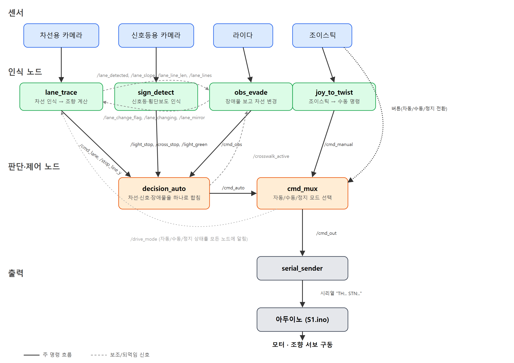
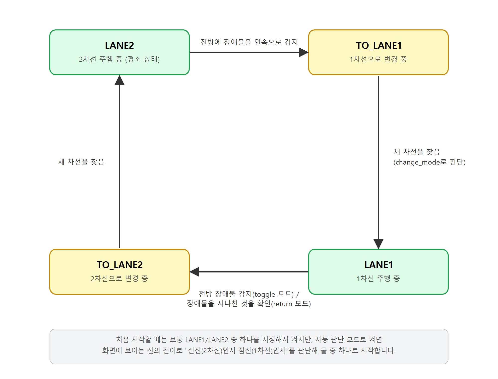

# S1 자율주행차 소프트웨어 설명서

이 폴더는 시중에서 파는 어린이용 전동차를 개조해 만든 자율주행차 "S1"을 움직이는 소프트웨어 전체가 들어있는 패키지입니다. 카메라로 차선과 신호등/횡단보도를 보고, 라이다(레이저 거리 센서)로 장애물을 피하고, 그 판단을 아두이노 보드로 보내 모터와 조향 장치를 움직이는 것까지 — "보고 → 판단하고 → 움직이는" 자율주행의 한 사이클 전체가 이 안에 있습니다.

이 설명서는 ROS2나 자율주행 코드를 처음 보는 사람도 전체 구조를 이해할 수 있도록 쓰였습니다. 위에서부터 차례로 읽으면 "이 프로젝트가 뭘 하는지" → "어떤 부품들이 어떻게 연결돼 있는지" → "코드 각 부분이 정확히 뭘 하는지" 순서로 이해할 수 있습니다.

> 이 소프트웨어의 뿌리가 된 자율주행 대회 출품작의 결과보고서(ROS1으로 작성된 예전 버전 코드 포함)와, 차량의 하드웨어 사양을 정리한 매뉴얼이 이 폴더 안에 PDF로 함께 들어있습니다. 지금 이 폴더의 코드는 그 대회 코드를 참고해 ROS2(아래에서 설명)로 새로 작성한 것입니다.

---

## 1. 처음 보는 사람을 위한 기초 개념

### 1.1 이 차가 자율주행을 하는 원리 (큰 그림)

모든 자율주행차는 기본적으로 같은 3단계를 반복합니다.

1. 센서로 주변을 본다 — 이 차는 카메라 2대(차선용 1대, 신호등용 1대)와 라이다 1대를 씁니다.
2. 무엇을 할지 판단한다 — "차선을 따라가려면 핸들을 얼마나 꺾어야 하나", "지금 멈춰야 하나", "장애물을 피해야 하나"를 계산합니다.
3. 모터를 움직인다 — 판단 결과를 실제 전진/후진 속도와 조향 각도로 바꿔서 모터와 서보에 전달합니다.

이 3단계를 1초에 여러 번(보통 10~20번) 반복하는 것이 자율주행 소프트웨어의 전부입니다. 이 폴더의 코드도 결국 이 3단계를 여러 개의 작은 프로그램으로 나눠서 구현한 것입니다.

### 1.2 ROS2란 무엇인가

이 프로젝트는 ROS2(Robot Operating System 2)라는 로봇 소프트웨어 프레임워크 위에서 동작합니다. ROS2 자체는 운영체제가 아니라, 여러 개의 작은 프로그램들이 서로 데이터를 주고받으며 협력하게 해주는 도구 모음입니다. 처음 보면 생소한 개념 3가지만 알면 이 폴더의 코드를 대부분 읽을 수 있습니다.

| 개념 | 쉬운 설명 |
|---|---|
| 노드(node) | 한 가지 일만 전담하는 작은 프로그램. 예: "카메라 영상을 보고 조향값을 계산하는 노드", "그 조향값을 아두이노로 전송하는 노드". 이 프로젝트에는 노드가 10개 가까이 있고, 각자 독립된 프로그램으로 동시에 실행됩니다. |
| 토픽(topic) | 노드들이 데이터를 주고받는 "게시판" 이름. 한 노드가 어떤 토픽에 데이터를 올리면(발행), 그 토픽을 구독하는 다른 노드들이 전부 그 데이터를 받습니다. 예: `/cmd_lane`이라는 토픽에는 "차선을 보고 계산한 조향 명령"이 올라옵니다. |
| 발행(publish) / 구독(subscribe) | 게시판에 글을 "쓰는 것"과 "읽는 것". 한 노드가 발행한 토픽을 여러 노드가 동시에 구독할 수도 있고, 반대로 여러 노드가 한 토픽에 발행할 수도 있습니다(이 경우 서로 덮어쓰게 되므로 주의가 필요합니다 — 뒤에서 실제 사례로 설명합니다). |

노드들은 직접 서로를 호출하지 않고, 전부 토픽을 통해서만 대화합니다. 그래서 "어떤 노드가 어떤 토픽을 발행하고 어떤 토픽을 구독하는지"만 알면 전체 시스템이 어떻게 연결되는지 그림으로 그릴 수 있습니다 — 아래 3장이 바로 그 그림입니다.

### 1.3 이 차가 쓰는 하드웨어

| 부품 | 역할 |
|---|---|
| 노트북(제어 컴퓨터) | 이 폴더의 소프트웨어 전체가 실제로 돌아가는 컴퓨터. 차량에 함께 실려서 이동하며, 아래의 카메라·라이다·아두이노가 전부 이 노트북의 USB 포트로 연결됩니다. 그래픽카드(GPU) 없이 CPU만으로도 동작하지만, 그 경우 신호등 인식이 간헐적으로 느려질 수 있습니다(5.2절). |
| 카메라 2대 (Logitech C920) | 한 대는 차선을 보는 용도, 다른 한 대는 신호등·횡단보도를 보는 용도. 서로 다른 각도로 고정 장착되어 있어 역할이 겹치지 않습니다. |
| 라이다 (RPLiDAR A2M8) | 레이저를 360도로 쏘아 주변 물체까지의 거리를 재는 센서. 전방에 장애물이 있는지 판단하는 데 씁니다. |
| 아두이노 메가 2560 | 모터(전진/후진)와 조향 모터를 실제로 구동하는 마이크로컨트롤러. 노트북이 보내는 텍스트 명령을 시리얼로 받아 모터를 돌립니다. |
| 조향 가변저항(포텐셔미터) | 앞바퀴 조향축에 달려, 지금 핸들이 얼마나 꺾여 있는지를 전압으로 재서 아두이노에 알려주는 센서. 목표 각도와 이 값을 비교해 조향 모터를 제어합니다. |
| 모터 드라이버 3개 | 아두이노가 보내는 약한 신호를 증폭해서 실제 모터를 구동하는 중간 장치. 왼쪽 구동모터·오른쪽 구동모터·조향 모터에 하나씩 씁니다. |
| 초음파 센서(HC-SR04) | 가까운 거리의 물체까지 거리를 재는 센서. 차량에는 장착되어 있지만, 지금 이 소프트웨어에는 이 센서 값을 쓰는 코드가 아직 없습니다. |
| 전원 계통(배터리·파워 서플라이·분배 단자대) | 보조 배터리 → 파워 서플라이 → 분배 단자대 → 모터 드라이버 순서로 전력을 공급합니다. |
| 조이스틱(게임 컨트롤러) | 사람이 수동으로 운전하거나, 자동/수동/정지 모드를 전환하는 데 씁니다. |

---

## 2. 전체 동작 흐름 한 장으로 보기

아래 그림은 이 프로젝트의 노드들이 어떤 토픽으로 연결되는지를 전부 나타낸 것입니다. 실선 화살표는 평소에 계속 흐르는 "주 명령 흐름"이고, 점선 화살표는 상태를 알려주는 "보조 신호"(대부분 뒤쪽 노드가 앞쪽 노드에게 "지금 이런 상황이니 참고해"라고 되먹임(feedback)하는 것)입니다. 화살표 방향이 "발행 → 구독" 방향입니다.



위 그림에서 눈여겨볼 점 두 가지:

- `lane_trace`와 `obs_evade`는 서로 정보를 주고받습니다. `lane_trace`는 "지금 선을 찾았는지, 어떤 모양인지"를 `obs_evade`에 알려주고, `obs_evade`는 "지금 몇 차선으로 가야 하는지"를 거꾸로 `lane_trace`에 알려줍니다. 둘 중 하나만 봐서는 전체 동작을 이해할 수 없고, 이 둘을 한 쌍으로 봐야 합니다.
- `cmd_mux`가 지금 자동/수동/정지 중 어느 모드인지(`/drive_mode`)를 다른 노드들에게도 알려줍니다. 예를 들어 `obs_evade`는 지금이 자동 모드일 때만 장애물을 감지합니다 — 사람이 손으로 차를 옮기는 중에 장애물로 오인해 갑자기 동작하지 않도록 하기 위해서입니다.

말로 풀어서 설명하면:

1. 차선용 카메라가 찍은 영상을 `lane_trace` 노드가 분석해서 "핸들을 이만큼 꺾고, 이 속도로 가면 된다"는 명령을 만듭니다. 같은 영상에서 횡단보도 앞 정지선도 함께 찾아서, 지금 정지선에 얼마나 다가갔는지도 알려줍니다.
2. 신호등용 카메라가 찍은 영상을 `sign_detect` 노드가 분석해서 "지금 신호등이 빨간불/노란불인지, 초록불인지"를 판단합니다.
3. 라이다가 측정한 거리 데이터를 `obs_evade` 노드가 분석해서 "전방에 장애물이 있으니 옆 차선으로 피해야 한다"는 명령을 만듭니다(평소엔 아무 명령도 내지 않습니다).
4. `decision_auto` 노드가 이 세 가지(차선 추종 / 정지 신호 / 장애물 회피) 결과를 받아서, 한 가지 우선순위 규칙에 따라 최종 명령 하나로 합칩니다. 이 규칙은 "멈춰야 하는 상황(빨간불·노란불)이 가장 먼저이고, 그다음이 장애물 회피, 마지막이 평소의 차선 추종"입니다 — 멈춰야 할 때 장애물을 피하느라 계속 움직이면 안 되기 때문입니다. 차선을 바꾸는 도중에 빨간불로 서면, 장애물 회피 노드도 그동안 차선 변경을 멈췄다가 출발하면 이어서 합니다.
5. 한편, 조이스틱 입력은 `joy_to_twist` 노드를 거쳐 "사람이 수동으로 조작한 명령"이 됩니다.
6. `cmd_mux` 노드가 지금이 자동 모드인지 수동 모드인지 정지 모드인지를 보고, 그에 맞는 명령(자동이면 4번 결과, 수동이면 5번 결과, 정지면 멈춤)을 최종으로 고릅니다. 이 선택은 조이스틱의 버튼으로 전환합니다.
7. `serial_sender` 노드가 그 명령을 아두이노가 알아듣는 짧은 텍스트(`"TH:300 STN:-120"` 같은 형식)로 바꿔서 시리얼(USB) 케이블로 보냅니다.
8. 아두이노 보드가 그 텍스트를 받아 실제 모터 PWM 값과 조향 서보 각도로 바꿔서 차를 움직입니다.

이 전체 과정이 `decision_auto` 기준으로 1초에 10번, `cmd_mux` 기준으로 1초에 20번 반복됩니다.

---

## 3. 폴더 구조

```
(이 설명서가 있는 폴더)
├── lane_trace/     차선 인식 → 조향/속도 계산
├── sign_detect/    신호등·횡단보도 인식
├── obs_evade/      라이다로 장애물을 보고 차선을 바꾸는 노드
├── sllidar_ros2/   라이다 제조사가 만든 공식 드라이버 (손대지 않고 그대로 사용)
├── s1_stack/       조이스틱 입력, 모드 전환, 최종 명령 결정, 아두이노로 전송 — 이 네 가지를 담당하는 노드 모음
├── Arduino/S1/     모터·조향 서보를 실제로 움직이는, 아두이노 보드에 올라가는 펌웨어 코드
├── docs/           실차로 테스트하며 남긴 날짜별 작업 기록
└── 결과보고서·매뉴얼 PDF 파일들
```

위 목록에서 "노드"라고 부른 것들은 각각 하나의 ROS2 패키지(폴더)이고, 폴더 하나당 보통 파이썬 코드 파일이 하나씩 들어있습니다.

---

## 4. 알고리즘에 쓰인 핵심 개념 설명

본격적으로 패키지별 코드를 보기 전에, 코드 안에서 반복해서 등장하는 용어 몇 가지를 먼저 풀어서 설명합니다.

### 4.1 HLS 색 공간과 "흰색 찾기"

사진은 보통 빨강/초록/파랑(RGB) 값으로 저장되지만, 이 값만 보고 "이 픽셀이 흰색인가"를 판단하면 햇빛이 강하거나 그림자가 지면 쉽게 틀립니다. 그래서 이 코드는 HLS(색상Hue·밝기Lightness·채도Saturation) 색 공간으로 바꿔서 "밝기가 일정 이상이고 채도(색이 얼마나 진한지)가 낮은 픽셀"을 흰색으로 판정합니다. 흰 선은 밝고 색이 거의 없는(채도가 낮은) 반면, 초록 잔디 같은 건 밝기는 비슷해도 채도가 높기 때문에 이 방식으로 구분이 됩니다.

### 4.2 Canny 엣지 검출과 Hough 변환으로 직선 찾기

흰색만 남긴 흑백 이미지에서 "선"을 찾아내는 데 쓰는 전통적인 컴퓨터 비전 기법 두 가지입니다.

- Canny 엣지 검출: 이미지에서 밝기가 급격히 바뀌는 경계선(엣지)만 뽑아내는 알고리즘. 차선의 테두리를 선 하나로 남깁니다.
- Hough 변환(`HoughLinesP`): 엣지로 남은 점들 중에서 "일직선으로 늘어선 점들의 묶음"을 찾아 직선 좌표(시작점, 끝점)로 변환하는 알고리즘. 이렇게 찾은 직선 후보들 중 조건(화면에서의 위치, 기울기 등)에 맞는 것만 "차선"으로 인정합니다.

### 4.3 상태 머신(state machine)이란

"지금 상황"을 몇 개의 정해진 상태로 나누고, 어떤 조건이 되면 다른 상태로 전환하는 식으로 프로그램을 짜는 방법입니다. 예를 들어 장애물 회피 노드는 평소 "2차선 주행 중" 상태에 있다가, 라이다가 장애물을 연속으로 여러 번 감지하면 "1차선으로 바꾸는 중" 상태로 넘어가고, 새 차선을 찾으면 "1차선 주행 중" 상태가 되는 식입니다. 신호등 앞에서 멈췄다가 출발하는 로직도 "정지선 기다리는 중 → 정지선에 도달 → (초록불 확인) → 지나가는 중"처럼 상태로 나눠서 짜여 있습니다. 지금 상태가 무엇인지만 알면 "다음에 무슨 일이 일어날지"를 예측할 수 있다는 것이 상태 머신의 장점입니다.

### 4.4 라이다와 "ROI(관심 영역)"

라이다는 차 주변 360도의 거리를 수백 개의 점으로 알려줍니다. 이 점들을 전부 보는 대신, "차 앞 1.3~1.6m, 좌우 폭 0.8m 안"처럼 관심 있는 영역(ROI, Region of Interest)만 잘라내서, 그 안에 점이 일정 개수 이상 연속으로 잡히면 "장애물이 있다"고 판단합니다. 영역을 너무 넓게 잡으면 옆 차선의 물체까지 장애물로 착각하고, 너무 좁게 잡으면 진짜 장애물을 놓치기 때문에 이 범위를 현장에서 여러 번 재보며 맞춥니다.

### 4.5 YOLO로 신호등/횡단보도 인식

신호등과 횡단보도는 선이 아니라 "사물"이기 때문에, 색/직선 찾기 대신 YOLO(You Only Look Once)라는 딥러닝 모델을 씁니다. YOLO는 사진 한 장을 보고 "여기에 신호등이 있고, 빨간불이고, 신뢰도는 92%다" 같은 결과(사각형 박스 + 분류 + 확신도)를 한 번에 내놓는 객체 인식 모델입니다. 이 프로젝트는 미리 학습시켜 둔 모델 파일(`best_0808.pt`)을 그대로 불러와서 씁니다 — 학습 자체는 이 폴더의 코드가 하는 일이 아닙니다.

### 4.6 시리얼 통신과 PWM

컴퓨터(노트북)와 아두이노는 USB 케이블로 연결되어 있고, 그 안에서 시리얼 통신(한 글자씩 순서대로 주고받는 통신 방식)으로 짧은 텍스트를 주고받습니다. 아두이노는 그 텍스트를 해석해서 모터에 PWM(Pulse Width Modulation, 모터에 "몇 퍼센트 세기로 켜져 있을지"를 빠르게 켜고 끄는 식으로 전달하는 방식) 신호를 내보내 속도를 조절하고, 조향은 목표 각도와 현재 각도(가변저항으로 측정)를 비교해서 모터를 돌리는 식으로 움직입니다.

---

## 5. 패키지별 상세 설명

### 5.1 `lane_trace` — 차선과 횡단보도 정지선 인식, 조향값 계산

차선용 카메라 영상을 받아서(`/cam_lane/image_raw` 토픽 구독), 차선을 찾아 조향/속도 명령(`/cmd_lane`)을 만들어 발행합니다. 노드 이름은 `lane_masking_node`입니다.

차선을 찾는 방식이 3가지 있고, 파라미터(`detector` 값)로 고를 수 있습니다.

| 방식 | 원리 |
|---|---|
| 1 (기본) | 4.1~4.2에서 설명한 HLS 흰색 필터 → Canny → Hough 직선 검출. 화면의 한쪽(오른쪽) 차선만 봄 |
| 2 | 흰 덩어리의 굵기·길이·채움 정도·모양으로 점선/실선/주차선/다른 차량을 구분해서 더 정확하게 선을 고르는 방식. 역시 한쪽만 봄 |
| 3 | 왼쪽·오른쪽 차선을 각각 찾아서, 두 선의 중앙과 두 선이 멀리서 만나는 점(소실점)을 이용해 조향을 계산하는 방식. 카메라가 차의 정면을 보도록 장착되어 있을 때 쓰는 방식이고, 커브 길에서 점선 조각들을 이어 붙여 곡선으로 인식하는 보정도 들어있음 |

그 밖에 하는 일:

- 지금 차가 1차선에 있는지 2차선에 있는지(`/lane_change_flag` 토픽으로 전달받음)에 따라 기준값을 다르게 써서 같은 로직으로 두 차선 모두 대응합니다.
- 차선을 한동안 못 찾으면(차량이 잠깐 가려지거나 조명이 바뀌는 경우 등) 일정 시간은 마지막으로 유효했던 조향값을 유지하고, 그래도 안 보이면 안전하게 속도를 0으로 낮춥니다.

같은 카메라 영상에서 횡단보도 인식도 함께 처리합니다. 화면에 비친 횡단보도 앞 정지선을 흰색 차선과 같은 방식(Canny+Hough)으로 찾아 그 화면상 위치(`/stop_line_y`)를 발행하면, `decision_auto`가 그 값으로 "지금 정지선에 충분히 다가갔는지"를 판단해 멈춥니다. 멈춘 뒤 다시 출발하는 판단(초록불 확인 등)은 5.2절의 `sign_detect`가 알려주는 신호등 색을 보고 합니다 — 즉 "어디서 멈출지"는 이 노드가, "언제 다시 갈지"는 신호등 쪽이 담당하는 구조입니다.

### 5.2 `sign_detect` — 신호등 인식

신호등용 카메라 영상을 받아서(`/cam_front/image_raw`), 4.5절에서 설명한 YOLO 모델로 추론합니다. 모델 자체는 횡단보도·빨간불·노란불·초록불 네 가지를 구분할 수 있지만, 횡단보도 위치는 위 5.1절처럼 차선용 카메라의 정지선으로 이미 더 정확하게 잡고 있으므로, 실제로 쓰는 것은 신호등 색(빨간불/노란불/초록불) 판단입니다.

- 신호등은 확신도와 박스 크기(= 화면에서 얼마나 크게 보이는지, 즉 얼마나 가까운지)가 둘 다 기준을 넘어야 유효로 칩니다. 한 번 빨간·노란불로 서면 박스 크기 기준을 70%로 낮춰서, 빨간불이 노란불로 바뀔 때 박스가 조금 작게 잡혀도 정지가 풀리지 않게 합니다.
- 한 프레임만 보고 바로 판단하지 않고, 최근 5프레임 중 3프레임 이상에서 같은 결과가 나와야 최종으로 확정합니다 — 한 프레임의 오인식 때문에 차가 갑자기 서거나 출발하는 것을 막기 위한 안전장치입니다.
- 결과는 `/light_stop`(빨간불/노란불이라 멈춰야 함), `/light_green`(초록불) 두 토픽으로 나갑니다(`/cross_stop`은 모델이 계산은 하지만 `decision_auto`가 참고하지 않습니다).
- 그래픽카드(GPU) 없이 CPU만으로 이 모델을 돌리면, 컴퓨터 성능에 따라 간헐적으로 1~3초씩 멈추는 현상이 있습니다. 이렇게 멈춰서 신호 정보가 오래 끊기면 `decision_auto`가 안전하게 차를 멈추므로, 사람이 보기에는 차가 갑자기 서는 것처럼 보일 수 있습니다.

### 5.3 `obs_evade` — 라이다로 장애물을 보고 차선 바꾸기

평소에는 아무 일도 하지 않고 조용히 있다가(`/cmd_obs`에 아무것도 발행하지 않음), 라이다 데이터(`/scan`)를 보고 4.4절에서 설명한 방식으로 전방에 장애물이 있다고 판단되면 동작을 시작합니다.

4.3절에서 설명한 상태 머신으로 동작하며, 상태는 "2차선 주행 중 → 1차선으로 바꾸는 중 → 1차선 주행 중 → 2차선으로 바꾸는 중 → (반복)"입니다.



차선을 바꾸는 중에는 조향/속도 명령을 `/cmd_obs`로 직접 발행해서, `decision_auto`가 이걸 차선 추종보다 우선으로 쓰게 합니다. 바꾸는 동작(TO_LANE1/TO_LANE2 상태)이 끝났다고 판단하는 방식은 세 가지가 있습니다.

| 방식 | 어떻게 끝을 판단하나 |
|---|---|
| `timed` | 정해 둔 시간(초)만큼 핸들을 꺾었다가 되돌리는, 가장 단순한 방식 |
| `camera` | `lane_trace`가 보내는 "지금 선을 찾았는지" 신호로, 원래 보던 선이 사라지고 새 차선의 선을 다시 찾을 때까지 꺾음 |
| `vision` | `lane_trace`가 보내는 "화면에 보이는 선들의 위치·기울기 목록"을 직접 보고, 새 차선 쪽 선이 원하는 위치에 왔는지로 판단 — 속도가 달라져도 다시 맞출 필요가 없는 방식 |

장애물을 만났을 때 "항상 반대 차선으로 바꾼다"(`toggle`)와 "장애물을 지나치면 원래 차선으로 돌아온다"(`return`) 두 가지 동작 모드도 선택할 수 있습니다.

### 5.4 `sllidar_ros2` — 라이다 드라이버

라이다 제조사(Slamtec)가 배포하는 공식 드라이버 코드를 그대로 가져온 것입니다. 하는 일은 라이다 하드웨어와 통신해서 거리 측정값을 `/scan` 토픽으로 발행하는 것뿐이고, 이 프로젝트에서 따로 수정하지 않았습니다.

### 5.5 `s1_stack` — 조이스틱 입력부터 아두이노 전송까지

이름대로 자율주행 "스택(여러 층)" 중 제어 쪽을 모아놓은 패키지입니다. 노드 4개로 이루어져 있습니다.

- `joy_to_twist`: 조이스틱 입력(`/joy`)을 읽어서 "사람이 조작한 조향/속도" 명령(`/cmd_manual`)으로 바꿉니다.
- `decision_auto`: 2장에서 설명한 대로, 차선/신호/장애물 세 가지 자동 판단을 우선순위에 따라 하나로 합쳐 `/cmd_auto`를 만듭니다. 신호등 정지를 판단하는 방법이 두 가지 있는데, 기본값(`stop_line_mode: false`, 지금 설정)은 신호등 카메라가 보내는 신호(박스 크기로 거리를 추정)만 보는 것이고, 설정을 바꾸면 차선 카메라가 찾은 정지선의 화면 위치로 "정지선에 도달했는지"를 직접 판단하는 더 정교한 방식도 쓸 수 있습니다(신호등 앞에 정지선이 있는 코스용). 이 경우 정지선에서 멈춘 뒤에는 초록불이 일정 시간 이상 계속 보여야 다시 출발합니다 — 신호가 아주 잠깐 흔들려 잘못 보이는 것 때문에 성급하게 출발하지 않도록 하는 안전장치입니다.
- `cmd_mux`: 조이스틱 버튼으로 자동(A) / 수동(B) / 정지(Y) 세 모드를 전환하고(수동 조작은 왼쪽 스틱 위아래가 속도, 오른쪽 스틱 좌우가 조향), 그 모드에 맞는 명령(자동이면 `/cmd_auto`, 수동이면 `/cmd_manual`, 정지면 0)을 최종 명령(`/cmd_out`)으로 내보냅니다. 자동 모드인데 `/cmd_auto`가 일정 시간 넘게 끊기면, 안전을 위해 자동으로 수동 모드로 바꿉니다.
- `serial_sender`: `/cmd_out`을 받아서 4.6절에서 설명한 시리얼 통신으로 아두이노에 전송합니다. 보내는 텍스트는 `"TH:<속도> STN:<조향>"` 형식이고, 속도/조향 값은 각각 -1000~1000 범위의 정수입니다. USB 연결이 순간적으로 끊겨도 프로그램이 멈추지 않고, 정지 상태로 기다리다가 자동으로 재연결합니다.

### 5.6 `Arduino/S1/S1.ino` — 모터·조향을 실제로 움직이는 펌웨어

컴퓨터가 아니라 아두이노 보드 안에서 직접 실행되는 코드입니다. 시리얼로 받은 `"TH:/STN:"` 텍스트를 해석해서, 전후진 모터는 PWM 값으로, 조향은 목표 각도와 현재 각도(가변저항으로 측정)를 비교해 모터를 돌리는 방식으로 제어합니다. 컴퓨터로부터 신호가 일정 시간 넘게 안 오면(케이블이 빠지는 등) 아두이노 자체적으로 정지시키는 안전장치도 들어있습니다.

---

## 6. 빌드하고 실행하는 방법

**필요 환경**: Ubuntu 22.04 (jammy) + ROS2 humble. 실제 개발·테스트가 전부 이 조합(네이티브 설치, WSL2/VirtualBox 아님)에서 이루어졌고, FMTC 노트북도 Ubuntu 22.04 humble로 고정되어 있어 그대로 맞습니다. Ubuntu 24.04(noble)는 ROS2 jazzy용이라 버전이 다르므로 이 코드를 그 환경에 맞춰 바꿀 필요는 없습니다.

```bash
# 이 폴더의 상위 폴더(colcon 워크스페이스 루트)에서
colcon build --symlink-install
source install/setup.bash

ros2 launch s1_stack s1_stack.launch.py
```

위 한 줄로 조이스틱 입력, 모드 전환, 최종 명령 결정(`decision_auto`), 아두이노 전송, 라이다, 카메라 2대까지 한 번에 실행됩니다. `decision_auto`는 `s1_stack/config/front_1019.yaml` 설정으로 켜집니다. 다만 `lane_trace`, `sign_detect`, `obs_evade` 세 노드는 따로 실행해야 합니다(컴퓨터 성능이 넉넉하지 않아, 어떤 노드가 어떤 CPU 코어를 쓸지 나눠서 배정하기 위해 일부러 분리되어 있습니다). 아래는 FMTC 노트북(10코어) 기준입니다:

```bash
OMP_NUM_THREADS=4 taskset -c 6-9 ros2 run sign_detect sign_detect --ros-args --params-file ~/FMTC_intern/s1_stack/config/front_1019.yaml
taskset -c 0-5 ros2 run lane_trace lane_trace --ros-args --params-file ~/FMTC_intern/s1_stack/config/front_1019.yaml
# 차를 2차선 출발 위치에 놓은 뒤, 주행마다 새로 켬(1차선에 놓고 시작하면 -p start_lane:=1)
taskset -c 0-5 ros2 run obs_evade obs_evade --ros-args --params-file ~/FMTC_intern/s1_stack/config/front_1019.yaml
```

`obs_evade`는 지금 몇 차선에 있는지를 자기가 한 차선 변경으로만 기억합니다. 조이스틱으로 차를 옮기거나 중간에 끊기면 그 기억이 실제와 어긋나므로, 주행마다 다시 켜야 합니다.

`s1_stack/config/` 폴더 안에는 실제 차량 테스트에서 썼던 설정 파일들이 들어있습니다. 카메라를 어떤 각도로 설치했는지에 따라 `lane_trace`가 봐야 할 기준값이 완전히 달라지므로, 설정 파일은 지금 실제로 장착된 카메라 각도에 맞는 것을 골라 써야 합니다 — 예를 들어 차선용 카메라가 차의 정면을 보도록 설치되어 있다면 그에 맞춰 만들어진 설정 파일을, 오른쪽을 보도록 설치되어 있다면 그에 맞는 다른 설정 파일을 써야 하고, 서로 섞어 쓰면 안 됩니다. `sign_detect`의 `model_path`는 지정하지 않으면 이 패키지와 함께 설치된 기본 모델 파일(`best_0808.pt`)을 그대로 쓰므로, 보통은 따로 지정할 필요가 없습니다. 다른 모델 파일을 쓰고 싶을 때만 `-p model_path:=<경로>`로 지정합니다.

디버그용으로 인식 결과를 화면에 띄워 보고 싶으면 `lane_trace`/`sign_detect` 실행 시 `-p debug_view:=true`를 추가하면 됩니다(화면이 있는 환경에서만 사용 가능).

실제 실험에서 썼던 정확한 파라미터 값과 실행 순서, 당시 현장에서 겪은 문제들은 `docs/summary/`와 `docs/records/` 폴더의 날짜별 기록에 자세히 남아있습니다.

### 6.1 정상적으로 실행되고 있는지 확인하는 법

노드를 켠 터미널 자체에는 로그가 빠르게 지나가서 한눈에 알아보기 어렵습니다. 다른 터미널을 하나 더 열어서 `ros2 topic echo <토픽 이름>`을 실행하면, 그 토픽에 지금 실제로 어떤 값이 흐르고 있는지 멈춰 있는 스냅샷처럼 볼 수 있습니다. 아래는 각 상황에서 "이런 모양의 값이 나오면 정상"이라고 볼 수 있는 예시입니다(실제 숫자는 그때그때 다릅니다).

라이다가 제대로 값을 보내고 있는지 확인:

```
$ ros2 topic echo /scan --once
header:
  frame_id: laser
angle_min: -3.1415927
angle_max: 3.1415927
angle_increment: 0.0157
range_min: 0.15
range_max: 12.0
ranges: [1.23, 1.19, 1.05, 0.97, ... , 1.31, 1.42]
---
```
`ranges` 배열이 비어있지 않고, 숫자들이 `range_min`~`range_max` 사이의 거리(단위: m)로 채워져 있으면 라이다가 정상적으로 주변 거리를 재고 있는 것입니다. 라이다 바로 앞을 손으로 가려 보면, 그 방향에 해당하는 값이 0에 가깝게 뚝 떨어지는 것도 확인할 수 있습니다.

`lane_trace`가 차선을 보고 조향값을 잘 계산하고 있는지 확인:

```
$ ros2 topic echo /cmd_lane --once
linear:
  x: 0.5
  y: 0.0
  z: 0.0
angular:
  x: 0.0
  y: 0.0
  z: -120.0
---
```
`linear.x`가 0보다 크면(차선을 잘 찾아서 전진 중) 정상입니다. 차를 들어 올린 채로 좌우로 흔들어 보면, 차선이 화면에서 움직이는 방향에 따라 `angular.z` 값(조향)이 같이 바뀌는 것을 볼 수 있습니다. 차선을 아예 가려서 안 보이게 하면 `linear.x`가 0으로 떨어집니다(5.1절의 안전장치).

마지막으로 합쳐진 최종 명령이 실제로 나오고 있는지 확인:

```
$ ros2 topic hz /cmd_auto
average rate: 10.021
    min: 0.095s max: 0.102s std dev: 0.00234s window: 50
```
`average rate`가 10 근처로 꾸준히 찍히면, `decision_auto`가 끊기지 않고 1초에 10번씩 명령을 내보내고 있다는 뜻입니다. 이 값이 한동안 안 찍히거나 0으로 떨어지면, 입력 신호(차선/신호등) 중 하나가 끊긴 것입니다.

---

## 7. 개발 환경을 새로 꾸릴 때 참고할 점 (가상 머신/WSL2 환경)

실제 차량이 아니라 노트북 안의 가상 리눅스 환경(WSL2나 VirtualBox 같은 가상 머신)에서 먼저 코드를 돌려 보려는 경우, 자주 겪게 되는 문제 두 가지를 미리 적어둡니다.

1. 빌드가 "성공한 것처럼 보이는데" 실제로는 패키지가 등록되지 않는 문제: 딥러닝 라이브러리들을 설치하는 과정에서 최신 버전의 빌드 도구가 함께 설치되면서, 이 ROS2 버전이 요구하는 더 오래된 빌드 방식과 충돌하는 경우가 있습니다. `ros2 pkg list`로 패키지 목록을 확인했을 때 만든 패키지들이 안 보인다면 이 문제를 의심해 보고, 빌드 도구 버전을 낮춘 뒤 빌드 폴더를 지우고 처음부터 다시 빌드해야 합니다.
2. 가상 환경에서 노드끼리 서로를 찾지 못하는 문제: 가상 네트워크가 ROS2의 기본 통신 방식(네트워크 안에서 서로를 자동으로 찾는 방식)을 막는 경우가 있습니다. 통신 방식을 다른 것으로 바꾸면 해결되는 경우가 많습니다.

또한, 이 프로젝트처럼 카메라 영상(용량이 큰 데이터)을 주고받는 코드는 가상 머신 환경에서는 영상이 아예 전달되지 않는 현상이 확인된 적이 있습니다. 카메라를 쓰는 부분은 실제 운영체제가 설치된 컴퓨터(가상 머신이 아닌 환경)에서 테스트하는 것을 권장합니다. USB로 연결하는 카메라·라이다·아두이노를 가상 머신 안으로 연결하려면 별도의 USB 연결 도구가 필요하며, 컴퓨터를 재시작할 때마다 다시 연결해 주어야 합니다.
